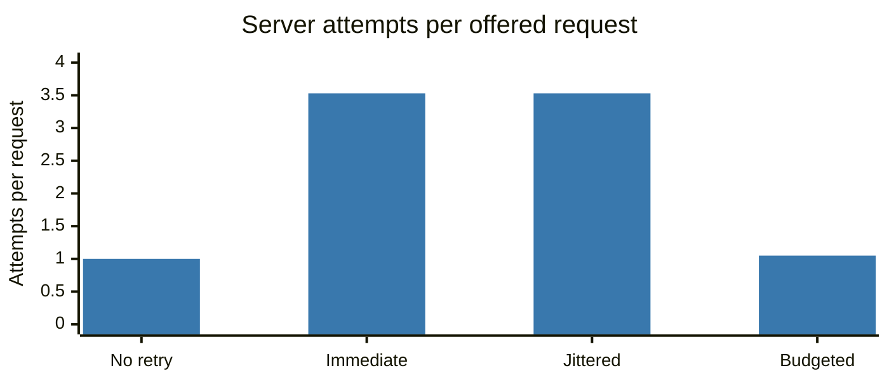
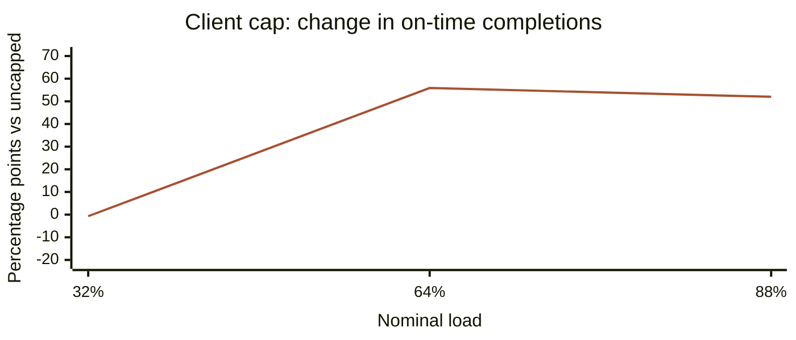

# Generation Interrupted

A resilience lab for chat clients. Break a response before or after the first text, compare what the user sees, and measure when retries help or make an outage worse.

## Quick start

Requires Node.js 26, pnpm, and uv. The scripted demo does not need a model or an API key.

```sh
pnpm --dir demo install --frozen-lockfile
pnpm --dir demo build
uv run --no-project --python 3.12 --with-editable . -- python -m uvicorn generation_cut.server:app --host 127.0.0.1 --port 8766
```

Open [Generation Interrupted](http://127.0.0.1:8766/demo/). Start with **After text** to compare the visible transcript when the client restarts, keeps a partial answer, or replays a scripted suffix.

## Streaming demo

| Lab | What it compares |
| --- | --- |
| [Streams](http://127.0.0.1:8766/demo/) | Five retry and replay policies, including a restart limited by time and work. |
| [Reconnect](http://127.0.0.1:8766/demo/reconnect/) | Reattach to the same generation after a browser disconnect, or start a new generation after an upstream cut. |
| [Stall](http://127.0.0.1:8766/demo/stall/) | Wait, keep the partial answer, or retry when a connection stays open but stops delivering text. |
| [Admission](http://127.0.0.1:8766/demo/admission/) | A bounded queue versus deadline-aware admission on the same burst. |
| [Shared backend](http://127.0.0.1:8766/demo/shared-backend/) | Queueing, cancellation, and saturation when logical users share one backend. |

**Local Ollama** is optional. It streams real model output; the scripted modes use controlled fixtures. See the [streaming runbook](docs/experiments.md#streaming-labs) for setup and how to read the counters.

## Compare server recovery

The [Recovery lab](http://127.0.0.1:8766/demo/recovery/) compares retries, client limits, server safeguards, and recovery windows against a local HTTP mock. Two comparisons show why both **work sent to the server** and **requests completed on time** matter.

### Retries can amplify an outage



In the [baseline retry storm](docs/experiments.md#baseline-benchmark), jitter alone did not lower attempts. Backoff with a retry budget stayed near one server attempt per offered request. Bars show medians across three seeds.

### A client cap is not always a win



The [two-worker load sweep](docs/experiments.md#load-and-workers) shows median paired changes across three seeds. The cap helped at higher load in this mock, but neither policy confirmed recovery at 88% within the observed window. In the [partial-outage runs](docs/experiments.md#outage-shapes), the cap reduced server attempts but hurt on-time completions in every two-worker pair.

<details>
<summary>Generate reports for the dashboard</summary>

Reports are generated locally and not included in a fresh checkout. The scripted streaming demo works without them. With the dashboard running, use a second terminal:

```sh
uv run --no-project --python 3.12 --with-editable . -- python -m generation_cut.recovery --seeds 1 --duration 8 --outage 1 3
```

Reload **Recovery** after the run. Its other views have separate recipes in the [experiment runbook](docs/experiments.md), including [sustained recovery](docs/experiments.md#sustained-recovery), [single faults](docs/experiments.md#single-faults), and [streaming admission](docs/experiments.md#streaming-admission).

</details>

<details>
<summary>Run tests</summary>

```bash
uv run --no-project --python 3.12 --with-editable '.[dev]' -- pytest -q
pnpm --dir demo test
```

</details>

## Scope

Generation Interrupted is a controlled lab, not a production gateway. The load studies use local mock service times and finite observation windows. Local Ollama studies exercise real streaming and admission, not a real-model retry storm or hosted inference. The [runbook](docs/experiments.md#measurement-limits) explains what remains untested.

The [original benchmark data](docs/experiment.json) is preserved separately from the streaming and recovery studies.
